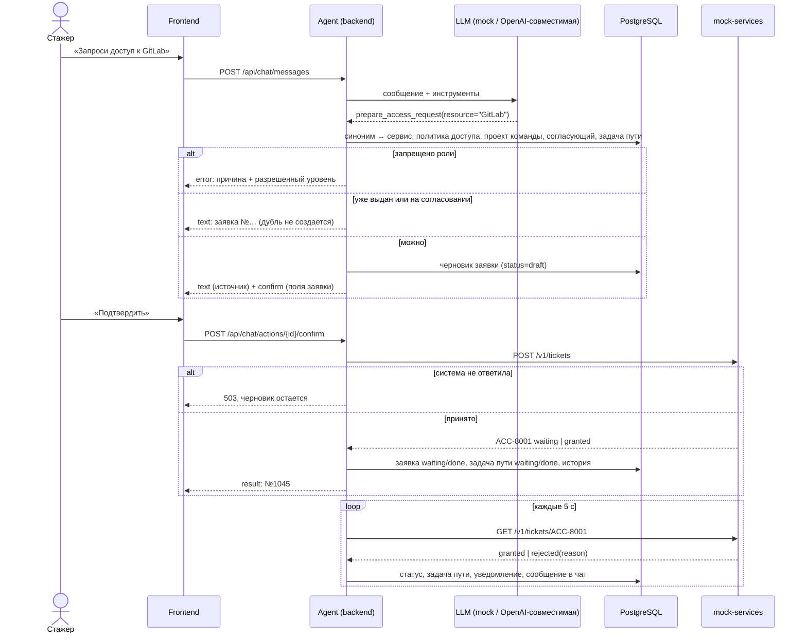

# 003. План: получение доступа

## Последовательность

## Решения

- **Черновик заявки вместо «действия в памяти».** Подтверждение – это перевод `draft → waiting`. Состояние карточки (ждет, подтверждена, отменена) не хранится отдельно, а выводится из статуса заявки. Так история чата после перезагрузки показывает правильные кнопки.
- **Один путь для mock и настоящей модели.** Mock тоже отвечает вызовом инструмента, поэтому права, подтверждение и заявка проверяются одинаково. Модель не получает права что-то выполнять: она только выбирает инструмент, а агент проверяет и делает.
- **Синонимы сервисов в таблице `service_aliases`.** «Репозиторий», «битбакет», «гитлаб» – это GitLab. Новый синоним добавляется строкой, без кода.
- **Ответ из справочника – только при покрытии вопроса не меньше половины слов.** Иначе «сколько стоит компьютер» находило «Сколько ждать согласования».
- **Синхронизация опросом.** Простой и надежный способ для демо. В продакшене – вебхук системы заявок или outbox и Redis Streams (день 4).
- **Таймаут модели и офлайн-ответ.** Модель недоступна – агент отвечает через mock, сбой пишется в `agent_tool_calls`.

## Данные

Миграция 012: `service_aliases`, уникальный `requests.external_ref`, индекс ожидающих заявок, задача «трекер прогресса» стала заявкой на доступ. Используются таблицы из 008: `requests`, `access_request_details`, `leave_request_details`, `request_events`, `conversations`, `messages`, `message_sources`, `handoffs`, `agent_tool_calls`.

## Код

- `internal/llm` – провайдеры mock и openai_compat.
- `internal/integrations` – интерфейс системы заявок и REST-клиент; `internal/mockservices` + `cmd/mockservices` – имитация (не входит в покрытие).
- `internal/repository/requests.go`, `chat.go` – SQL.
- `internal/services/agent.go` – агент, `requests.go` – страница «Заявки» и синхронизация, `dates.go` – даты отгула.
- `internal/handlers/chat.go` – HTTP.
