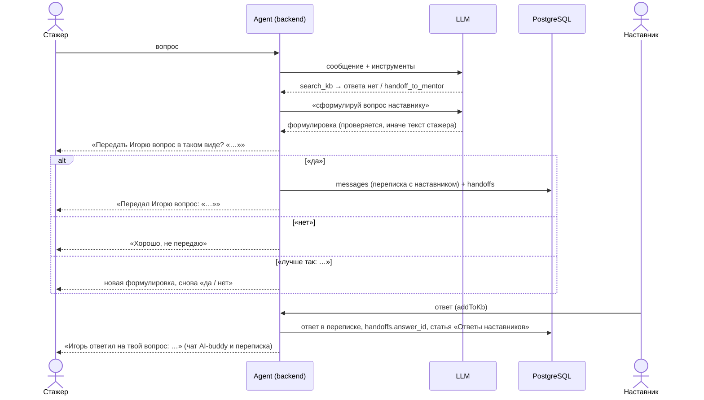

# 004. План: вопрос наставнику

## Последовательность

## Решения

- **Согласие проверяет backend, а не модель.** Реплики «да», «нет», «лучше так:» после предложения передать разбираются регулярными выражениями до вызова модели (`handoffIntent`). Модель ошибается в действиях с последствиями, поэтому решение о передаче за правилами.
- **Предложение хранит формулировку.** Текст предложения содержит маркер «в таком виде» и вопрос в «кавычках»; на «да» агент берет вопрос из последнего сообщения помощника. Отдельной таблицы черновиков не нужно, история чата переживает перезагрузку.
- **Защита от обещаний без действия.** Если ответ модели без вызова инструмента содержит «передал», «создам», «посмотрю» (`reClaim`), агент повторяет запрос с подсказкой; при повторном отказе предлагает передачу сам.
- **Формулировку пишет модель, но с проверкой.** Отбрасываются пустые, длинные, содержащие «передать», «наставник», «справочник» (признак ответа вместо вопроса) и обещания действий.
- **Нет наставника – руководитель.** Получатель берется из связей стажера в базе, имена в ответе тоже.

## Данные

Таблицы `conversations` (kind `mentor`), `messages`, `handoffs` (`question_id`, `forwarded_id`, `answer_id`, `answer_article_id`), `kb_articles` (раздел «Ответы наставников»). Миграции 008, 019.

## Код

- `internal/services/agent.go` – `handoffIntent`, `offerHandoff`, `formalQuestion`, `handoffQuestion`, `handoff`, `reClaim`.
- `internal/repository/chat.go` – `Handoff`; `internal/repository/mentor.go` – переписка, ответ, статья.
- Frontend: `components/mentor/ThreadMessageView.tsx` (карточка переданного вопроса), `pages/InboxPage.tsx`, `pages/MentorChatPage.tsx`.
