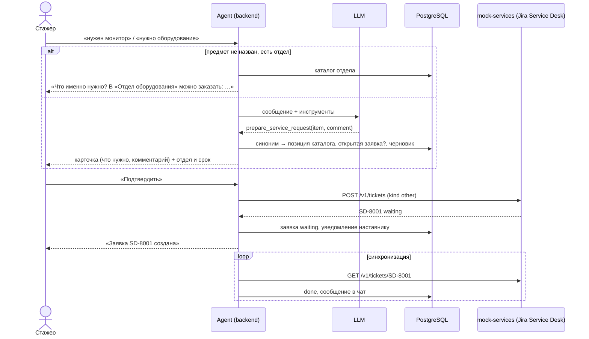

# 005. План: заявки в отделы

## Последовательность

## Решения

- **Каталог и синонимы в базе** (`catalog_items`, `catalog_aliases`): при нескольких совпадениях выигрывает самый длинный синоним («зарядка для ноутбука» → другое оборудование, а не ноутбук).
- **Уточнение до модели.** Общая просьба к отделу («оборудование», «бухгалтерия») без предмета разбирается правилом: модель на такие запросы часто отвечала текстом без заявки.
- **Позиция «Другое оборудование»** вместо отказа: заявка все равно доходит до отдела, подробности в комментарии.
- **Один адаптер к системе заявок** для доступов, отделов и обращений в поддержку; при внедрении заменяется на API Jira Service Desk или MCP-сервер.

## Данные

Миграции 013 (отделы, каталог, синонимы, `service_request_details`), 021 (другое оборудование и новые синонимы).

## Код

- `internal/services/agent.go` – `prepareService`, `departmentHelp`, `reServiceAsk`; `agent_service.go` – `catalogHelp`, уведомление наставнику.
- `internal/repository/requests.go` – `ResolveItem`, `CatalogItem`, `CreateServiceDraft`.
- Frontend: `pages/SupportPage.tsx` (кнопка «Оформить заявку»), `pages/RequestsPage.tsx`.
